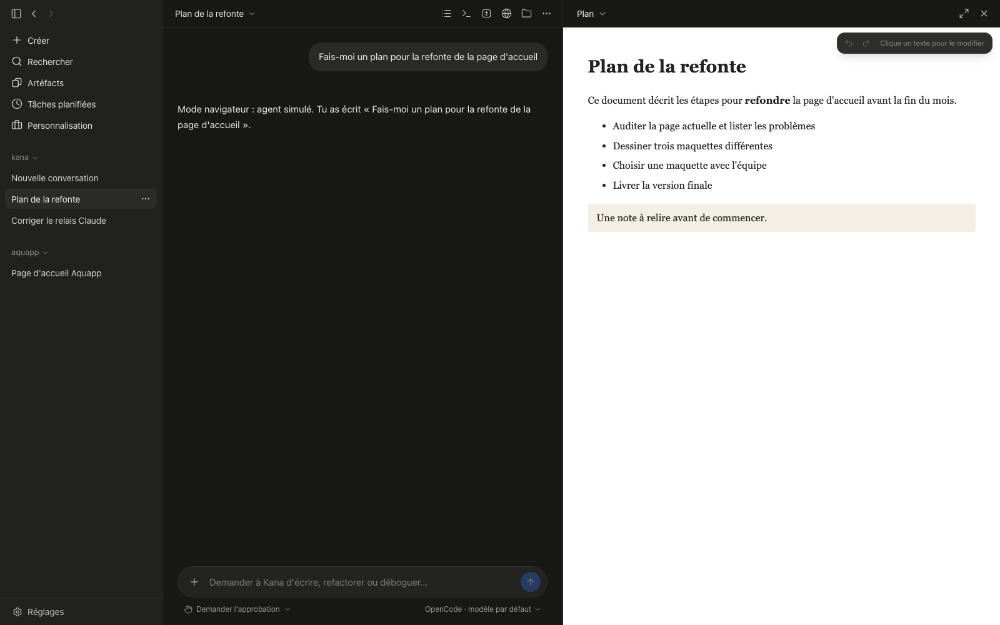

<p align="center">
  
</p>

<h1 align="center">Kana</h1>

<p align="center">
  <strong>Le poste de pilotage de vos agents de code.</strong><br />
  Claude Code, Codex, Gemini CLI et OpenCode dans une seule application de bureau, native et rapide.
</p>

<p align="center">
  <a href="https://github.com/HarpeLm/kana/actions/workflows/ci.yml"></a>
  
  
  
  
</p>

<p align="center">
  
</p>
<p align="center"><sub>Aperçu dans le navigateur, avec l'agent simulé : une conversation, et un artéfact qu'on corrige directement sur la page.</sub></p>

## Pourquoi Kana

Chaque agent de code a son terminal, ses réglages et ses limites. Kana les réunit derrière un seul protocole, l'[Agent Client Protocol](https://agentclientprotocol.com) (ACP), et ajoute ce qui manque à tous : un dossier de travail propre par conversation, un navigateur que les agents pilotent avec votre accord, des pages (« artéfacts ») qu'on relit et corrige à la main, et un relais automatique quand un fournisseur atteint sa limite.

## Ce que Kana sait faire

**Conversations**
- Plusieurs fournisseurs, un seul endroit : choisissez l'agent, le modèle et le **niveau d'effort**, et changez de fournisseur en cours de route (le nouvel agent reçoit un résumé).
- Quatre modes d'autorisation : approbation, **plan** (lecture seule, imposé par Kana), automatique, accès complet.
- Réponses lisibles : commandes repliables avec leur durée, réflexion repliée, liens vers des fichiers locaux (`App.tsx:42` s'ouvre à la bonne ligne), images jointes envoyées comme de vraies images.
- Titres de conversation écrits par l'agent, `/compact` avec le nombre de jetons économisés, jauge du contexte réel de chaque modèle.
- Réessayer, modifier un message sur place, copier, **bifurquer** une conversation depuis n'importe quel message.

**Un dossier de travail par conversation**
- Chaque conversation travaille dans son propre *worktree* git : plusieurs agents, aucun conflit.
- Panneau de session : branche, commits, fichiers modifiés, **diff** fichier par fichier, création d'une pull request avec confirmation, fusion ou abandon du travail.
- Nettoyage des worktrees et branches orphelins, sans jamais perdre de travail.

**Artéfacts**
- Un artéfact est une page HTML autonome dans `artefacts/` : plan, checklist, tableau de bord, maquette…
- **Galerie** avec aperçus, recherche, tri, vue en liste ; les artéfacts apparaissent aussi dans la recherche, avec un aperçu.
- **Éditeur visuel** : cliquez un texte pour le modifier, supprimez, ajoutez ou **déplacez une ligne** par glisser-déposer (les numéros suivent), annulez et rétablissez ; l'enregistrement est automatique.
- **Commenter un passage** : surlignez une phrase, écrivez ce qui ne va pas, l'agent ne modifie que cet endroit.

**Quota Relay**
- Détecte les limites atteintes et les connexions refusées, propose (ou fait automatiquement) de continuer chez un autre fournisseur avec le résumé de la conversation.
- Suivi de la consommation par fournisseur et par jour.

**Et aussi**
- **Globe** : un navigateur intégré, dont les agents se servent (outils MCP) avec votre accord, sessions conservées.
- Terminal, éditeur de fichiers (coloration, recherche, enregistrement), glisser-déposer de fichiers et de dossiers.
- Recherche globale (conversations, projets, artéfacts), barre latérale façon Claude Code avec dossiers, sections et épinglage.
- Clés d'API dans le Trousseau macOS.

## Architecture

| Dossier | Rôle |
| --- | --- |
| `apps/desktop` | L'application : Tauri v2, interface React 19 + Tailwind v4 |
| `crates/kana-acp` | Client ACP générique : sous-processus, JSON-RPC, flux d'événements, modèles, effort, modes |
| `crates/kana-core` | Logique métier, machine à états et routeur de bascule entre fournisseurs |
| `crates/kana-git` | Worktrees, branches, diffs, fichiers, pull requests |
| `crates/kana-db` | Persistance SQLite des conversations et de l'historique |
| `crates/kana-mcp` | Serveur MCP qui donne aux agents le contrôle du Globe |
| `crates/kana-pty` | Terminaux intégrés |

## Lancer Kana

Prérequis : [Rust](https://rustup.rs) (stable), [Node.js](https://nodejs.org) 22, git, les [prérequis de Tauri](https://tauri.app/start/prerequisites/) pour votre système, et au moins un agent installé (OpenCode, Claude Code, Codex ou Gemini CLI). La connexion de chaque agent se fait dans **Réglages**.

```bash
git clone https://github.com/HarpeLm/kana.git
cd kana/apps/desktop
npm install
npm run tauri dev
```

Pour essayer l'interface seule, sans Tauri (agent simulé) :

```bash
npm run dev    # puis ouvrir http://localhost:1420
```

Construire l'application :

```bash
npm run tauri build
```

## Tests

```bash
cargo test --workspace      # Rust
cd apps/desktop
npm test                    # logique de l'interface (Vitest)
npm run test:e2e            # écran dans le navigateur (Playwright)
```

Tout cela tourne à chaque push avec GitHub Actions.

## Licence

AGPL-3.0-only.
