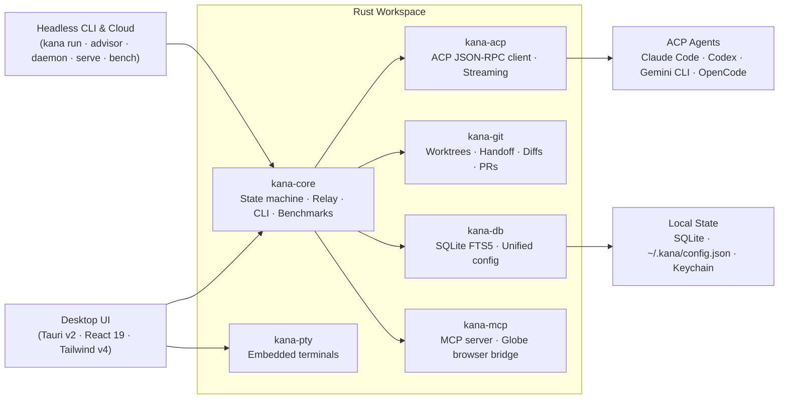

<p align="center">
  
</p>

<h1 align="center">Kana</h1>

<p align="center">
  <strong>The unified cockpit for your coding agents.</strong><br />
  Orchestrate <strong>Claude Code</strong>, <strong>Codex</strong>, <strong>Gemini CLI</strong>, and <strong>OpenCode</strong> inside one native, blazing-fast desktop app — seamlessly extended by a headless CLI and Kana Cloud.
</p>

<p align="center">
  <a href="https://github.com/HarpeLm/kana/actions/workflows/ci.yml"></a>
  
  
  
  
</p>

<p align="center">
  <a href="#features">Features</a> &nbsp;·&nbsp;
  <a href="#architecture">Architecture</a> &nbsp;·&nbsp;
  <a href="#cli--cloud">CLI &amp; Cloud</a> &nbsp;·&nbsp;
  <a href="#quick-start">Quick Start</a> &nbsp;·&nbsp;
  <a href="#tests">Tests</a>
</p>

<br />

<p align="center">
  
</p>
<p align="center">
  <sub>Kana workspace preview: multi-provider conversation on the left, live visual artifact editor on the right.</sub>
</p>

---

## Why Kana?

Every coding agent ships with its own terminal, configuration format, context window, and rate limits. **Kana** unifies them behind the [Agent Client Protocol](https://agentclientprotocol.com) (ACP) and adds the engineering infrastructure they all miss:

- **Zero lock-in, zero dead-ends** — switch providers mid-conversation or let **Quota Relay** take over automatically when a provider hits its rate limit.
- **True parallel execution** — every conversation runs in its own isolated Git *worktree* with hot bidirectional handoff, inline hunk review, and PR/CI feedback.
- **Full-stack agency** — built-in browser (**Globe**) with DevTools & multimodal vision, editable visual artifacts, MCP catalog, voice dictation, scheduled daemons, and a remote Web/Mobile companion (**Kana Cloud**).
- **100% unified state** — the desktop app and headless CLI share the same `SQLite FTS5` database, `~/.kana/config.json`, and macOS Keychain credentials.

---

## Features

<table>
  <tr>
    <td width="50%" valign="top">
      <h3>Multi-Provider ACP &amp; Quota Relay</h3>
      <ul>
        <li>Drive <strong>Claude Code</strong>, <strong>Codex</strong>, <strong>Gemini CLI</strong>, and <strong>OpenCode</strong> from a single interface with model &amp; effort selection.</li>
        <li><strong>Automatic Quota Relay</strong> detects rate limits and outages, seamlessly transferring context to a backup provider with per-day usage tracking.</li>
        <li>Four enforced permission modes: <em>Ask</em>, <em>Plan</em> (strict read-only), <em>Auto</em>, and <em>Full Access</em>.</li>
      </ul>
    </td>
    <td width="50%" valign="top">
      <h3>Cross-Review (A → B → C) &amp; <code>/advisor</code></h3>
      <ul>
        <li>Chain multiple providers in a <strong>Cross-Review pipeline</strong> where one agent drafts, another audits, and a third refines.</li>
        <li>AI-assisted <strong><code>/advisor</code></strong> analyzes your task and recommends the ideal provider, model, effort level, and execution strategy.</li>
        <li>Fork conversations from any message, retry, edit in place, or run <code>/compact</code> with real token-window telemetry.</li>
      </ul>
    </td>
  </tr>
  <tr>
    <td width="50%" valign="top">
      <h3>Isolated Git Worktrees &amp; Diff Review</h3>
      <ul>
        <li>Each session gets its own <strong>Git worktree</strong> so multiple agents work in parallel without file conflicts.</li>
        <li><strong>Hot bidirectional handoff</strong> between your main checkout and any worktree, plus safe orphan cleanup.</li>
        <li>Inline <strong>hunk-by-hunk diff review</strong>, comment-to-fix, PR creation with confirmation, and live CI check feedback.</li>
      </ul>
    </td>
    <td width="50%" valign="top">
      <h3>Globe — Built-In Agent Browser</h3>
      <ul>
        <li>Integrated browser controlled by agents via <strong>MCP tools</strong> with explicit user approval and persistent sessions.</li>
        <li>Built-in <strong>DevTools Inspector</strong> capturing Console logs and Network requests in real time.</li>
        <li><strong>Multimodal Vision</strong> screenshots and one-click <strong>HTML trace export</strong> for debugging UI workflows.</li>
      </ul>
    </td>
  </tr>
  <tr>
    <td width="50%" valign="top">
      <h3>Visual Artifacts &amp; Extensibility</h3>
      <ul>
        <li>Self-contained HTML <strong>Artifacts</strong> (plans, dashboards, checklists, mockups) with a searchable gallery and visual inline editor (click-to-edit, drag-to-reorder, highlight-to-comment).</li>
        <li><strong>Customizations hub</strong> for installing &amp; managing the <strong>MCP Catalog</strong>, reusable <strong>Skills</strong>, project <strong>Rules</strong>, and lifecycle <strong>Hooks</strong>.</li>
        <li>Integrated file editor with syntax highlighting, multi-terminal PTY dock, and drag-and-drop context.</li>
      </ul>
    </td>
    <td width="50%" valign="top">
      <h3>Voice, Scheduling &amp; Kana Cloud</h3>
      <ul>
        <li><strong>Voice dictation</strong> supporting real-time streaming, local <strong>Whisper</strong> transcription, and native macOS dictation.</li>
        <li><strong>Scheduled tasks</strong> with one-click macOS <code>launchctl</code> installation and background daemon execution.</li>
        <li><strong>Kana Cloud</strong> (<code>kana serve</code> + <code>Dockerfile.cloud</code>) for dispatching and monitoring agent jobs from any Web or Mobile browser.</li>
      </ul>
    </td>
  </tr>
</table>

> **Unified & Secure by Design** — Desktop and CLI share a single `SQLite FTS5` full-text index (instant global search across conversations, projects, and artifacts) and `~/.kana/config.json`, while API keys and tokens stay safely stored in the **macOS Keychain**.

---

## Architecture



| Crate / Folder | Responsibility |
| :--- | :--- |
| [`apps/desktop`](apps/desktop) | Native Tauri v2 desktop shell, React 19 + Tailwind v4 UI, Kana Cloud web/mobile companion |
| [`crates/kana-acp`](crates/kana-acp) | Generic ACP client: subprocess lifecycle, JSON-RPC streaming, models, effort levels, permission modes |
| [`crates/kana-core`](crates/kana-core) | Core state machine, Quota Relay failover router, CLI parser, advisor heuristics, benchmark harness |
| [`crates/kana-git`](crates/kana-git) | Isolated Git worktrees, bidirectional handoff, hunk diffs, orphan cleanup, PR & CI helpers |
| [`crates/kana-db`](crates/kana-db) | SQLite persistence with FTS5 full-text search across conversations, projects, and artifacts |
| [`crates/kana-mcp`](crates/kana-mcp) | Embedded MCP server exposing Globe browser automation, DevTools inspection, and vision capture |
| [`crates/kana-pty`](crates/kana-pty) | Native pseudo-terminal sessions powering the integrated terminal dock |

---

## CLI & Cloud

The same `Kana` binary powers both the native desktop app (when launched with no arguments) and a full headless CLI sharing `~/.kana/config.json` and the `SQLite FTS5` store:

```bash
# Run a headless coding task (with optional multi-provider cross-review)
kana run "Refactor the auth middleware and add unit tests" --agent claude --cross-review codex,gemini

# Ask the AI advisor for the best provider, model, and execution plan
kana advisor "Migrate our PostgreSQL schema with zero downtime"

# Execute due scheduled tasks in daemon mode (or once via launchctl)
kana daemon --once

# Start the Kana Cloud Web & Mobile companion server
kana serve --host 0.0.0.0 --port 8787 --token "$KANA_CLOUD_TOKEN"

# Evaluate agents on public benchmarks (SWE-bench, Terminal-Bench, WebArena)
kana bench --suite swe-bench --dataset ./tasks.jsonl --agent claude --docker --live
```

### Containerized Cloud Deployment

Deploy Kana Cloud anywhere using the bundled [`Dockerfile.cloud`](Dockerfile.cloud):

```bash
docker build -f Dockerfile.cloud -t kana-cloud .
docker run -p 8787:8787 -e KANA_CLOUD_TOKEN=your-secret-token kana-cloud
```

---

## Quick Start

### Prerequisites

- [Rust](https://rustup.rs) (stable, Edition 2024)
- [Node.js](https://nodejs.org) 22+ & `npm`
- Git and the [Tauri v2 system prerequisites](https://tauri.app/start/prerequisites/)
- At least one ACP-compatible agent installed: **Claude Code**, **Codex**, **Gemini CLI**, or **OpenCode**

### Run the Desktop App

```bash
git clone https://github.com/HarpeLm/kana.git
cd kana/apps/desktop
npm install
npm run tauri dev
```

### Preview the UI Only (Simulated Agent)

```bash
cd apps/desktop
npm run dev    # opens at http://localhost:1420
```

### Production Build

```bash
cd apps/desktop
npm run tauri build
```

---

## Tests

Every push is validated through GitHub Actions across the Rust workspace, TypeScript type-checking, Vitest unit tests, and Playwright end-to-end tests:

```bash
# Rust workspace unit & integration tests
cargo test --workspace

# Frontend type-checking, unit tests, and E2E suite
cd apps/desktop
npx tsc --noEmit
npm test
npm run test:e2e
```

---

## Contributing

Contributions are welcome! Please read [CONTRIBUTING.md](CONTRIBUTING.md) and our [Code of Conduct](CODE_OF_CONDUCT.md) before opening a pull request. To report a security vulnerability, follow [SECURITY.md](SECURITY.md).

## License

Kana is dual-licensed under your choice of the [Apache License 2.0](LICENSE-APACHE) or the [MIT License](LICENSE-MIT).

Unless you explicitly state otherwise, any contribution intentionally submitted for inclusion in Kana is dual-licensed as above, without any additional terms or conditions.
